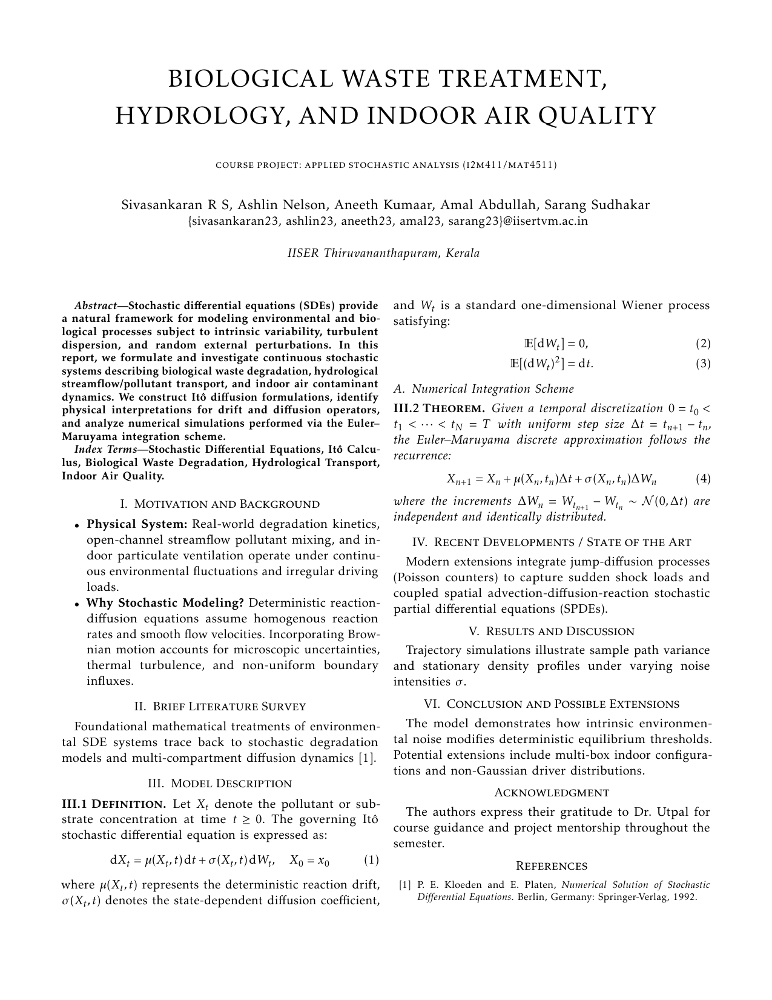

<pre style="font-family:'Courier New',Courier,monospace;font-size:12px;line-height:1.17;white-space:pre;background-color:#000;color:#fff;padding:8px;margin:0;">▐▓▓▓▓▌ ▐▓▓▓▓▌▐▓▓▓▓▌▐▓▌ ▐▓▌▐▓▌ ▐▓▌▐▓▓▓▓▓▌▐▓▓▓▓▌▐▓▌ ▐▓▌    ▐▓▓▓▓▌ ▐▓▓▓▓▌▐▓▓▓▓▌▐▓▓▓▓▌▐▓▌ ▐▓▌
▐▓▌ ▐▓▌▐▓▌▐▓▌▐▓▌▐▓▌▐▓▌ ▐▓▌▐▓▓▌▐▓▌  ▐▓▌  ▐▓▌▐▓▌▐▓▓▌▐▓▌    ▐▓▌ ▐▓▌▐▓▌   ▐▓▌   ▐▓▌▐▓▌ ▐▓▐▓▌ 
▐▓▓▓▓▓▌▐▓▓▓▓▌▐▓▌▐▓▌▐▓▐▓▐▓▌▐▓▐▓▐▓▌  ▐▓▌  ▐▓▓▓▓▌▐▓▐▓▐▓▌    ▐▓▌ ▐▓▌▐▓▓▓▌ ▐▓▌   ▐▓▓▓▓▌  ▐▓▌  
▐▓▌ ▐▓▌▐▓▐▓▌ ▐▓▌▐▓▌▐▓▐▓▐▓▌▐▓▌▐▓▓▌  ▐▓▌  ▐▓▌▐▓▌▐▓▌▐▓▓▌    ▐▓▌ ▐▓▌▐▓▌   ▐▓▌   ▐▓▌▐▓▌  ▐▓▌  
▐▓▓▓▓▌ ▐▓▌▐▓▌▐▓▓▓▓▌▐▓▓▓▓▓▌▐▓▌ ▐▓▌▐▓▓▓▓▓▌▐▓▌▐▓▌▐▓▌ ▐▓▌    ▐▓▓▓▓▌ ▐▓▓▓▓▌▐▓▓▓▓▌▐▓▌▐▓▌  ▐▓▌  </pre>

#### Deadline: **Nov 15, 2026** - Sunday.

## Requirements

### Primary Reference

**P. E. Kloeden and E. Platen**, _Numerical Solution of Stochastic Differential Equations_, Springer.  
Please refer to **Chapter 7 - Applications of Stochastic Differential Equations** (available in your course Google Classroom), which contains 10 sections illustrating application models across different domains.

---

### Selected Project Topic

**Biological Waste Treatment, Hydrology, and Indoor Air Quality**  
_(Derived from Section 7.5: Biological Waste Treatment, Hydrology, and Air Quality)_
[[Notes|Notes From the Section 7.5]]

---

### Project Expectations

Your project report should cover the following aspects. The write-up has to be typed in LaTeX.

1. **Motivation and Background:**
	1. Explain the real-world problem or phenomenon that the model aims to describe (e.g., stochastic dynamics in biological waste degradation, hydrological streamflow/pollutant dispersion, or indoor air contaminant concentrations).
	2. Discuss why a stochastic model (rather than a deterministic one) is more appropriate (e.g., accounting for random environmental fluctuations, flow velocity turbulence, and variable reaction rates).
2. **Brief Literature Survey:**
	1. Summarize key works or developments related to stochastic differential equation (SDE) models in waste treatment, hydrology, and indoor air quality dynamics.
	2. Cite a few relevant papers or books beyond the primary reference text to show awareness of the broader context.
3. **Model Description:**
	1. Present the mathematical formulation of the stochastic differential equation (SDE) model clearly.
	2. Describe each term in the SDE (drift term, diffusion term, Wiener process) along with its physical or probabilistic interpretation.
	3. Specify the numerical method (e.g., [Euler-Maruyama](https://en.wikipedia.org/wiki/Euler%E2%80%93Maruyama_method), [Milstein](https://en.wikipedia.org/wiki/Milstein_method)) used for simulation.
4. **Recent Developments / State of the Art:** 
	1. Identify any notable extensions, variations, or recent applications of SDE models in biological waste treatment, hydrology, or indoor air quality modelling. 
	2. Briefly describe how current research uses or improves upon this baseline model.
5. **Results and Discussion:** 
	1. Provide illustrative numerical simulations or analytical results. 
	2. Discuss what insights the model provides and how the stochastic noise component influences the outcomes.
6. **Conclusion and Possible Extensions:**
	1. Summarize key findings.
	2. Mention possible improvements, open questions, or applications in related environmental engineering fields.
7. **Bibliography**

---

## Report preview

---
